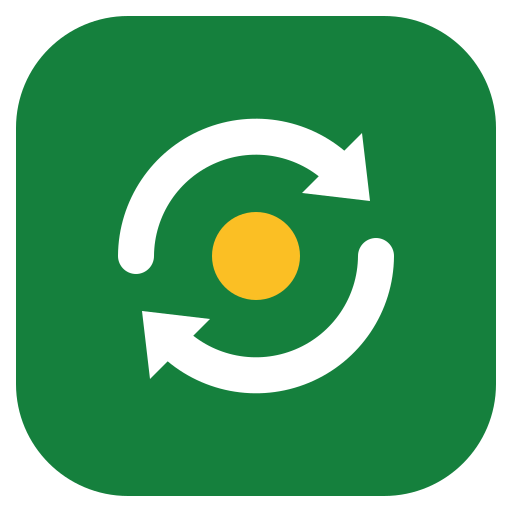
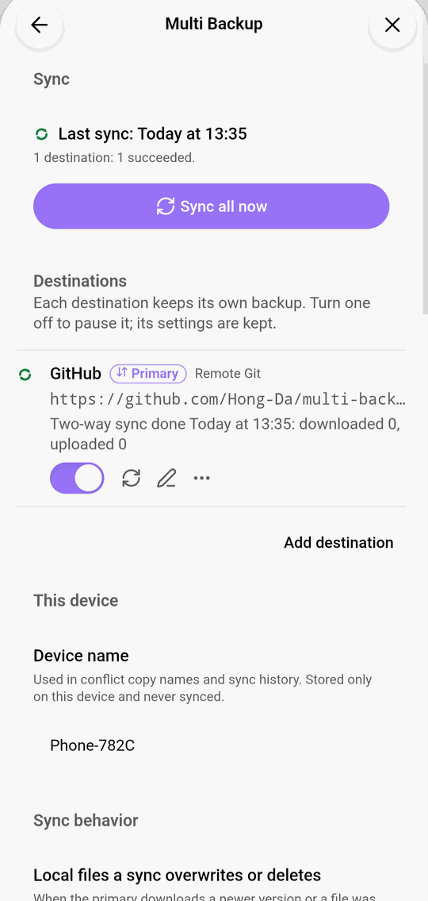
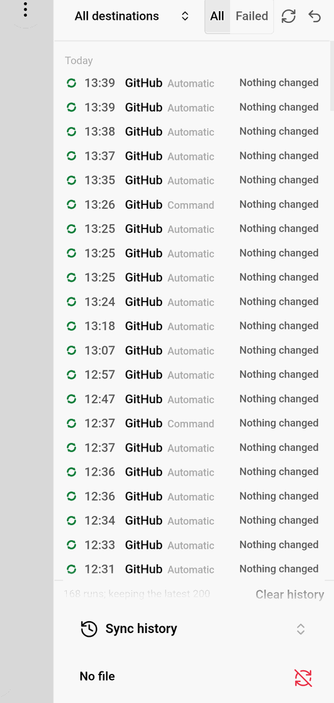
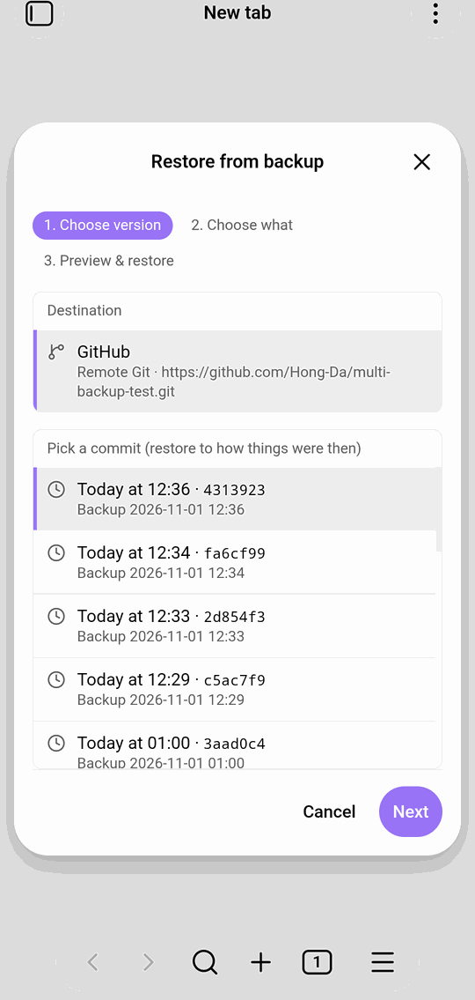

# Multi Backup

**English** | [简体中文](README.zh-CN.md)

Back up your vault to several places at once: local folders, Git hosts, WebDAV, S3-compatible storage and cloud drives. Pick one of them as the **primary** to keep your devices in sync both ways; the others stay one-way backups you can restore from at any time.

Works on desktop and mobile. Local-folder destinations are desktop only.

Full walkthrough with screenshots: **[User guide](docs/guide.md)**.

## Features

- **Many destinations at once**
  - Local folder mirror, zip snapshots, local Git repository (desktop)
  - GitHub, Gitee or any Git host over HTTPS
  - WebDAV: Nextcloud, Jianguoyun, and other drives through [Alist](docs/alist.md)
  - S3-compatible storage: AWS S3, Cloudflare R2, MinIO, Backblaze B2 and others
  - Dropbox (OneDrive and Google Drive are not available yet)
- **Two-way sync through one primary.** Changes, deletions and renames sync between devices. When a file changed on both sides, both versions are kept and listed for you to choose.
- **Automatic sync.** On a timer, after you stop editing, when Obsidian starts, or daily at a set time. Each destination has its own schedule.
- **Restore.** Restore the whole vault, a folder or one file from any destination, and see a file's version history. A restore can be undone.
- **Safe by design.** A failed sync never changes your local files. Before a sync overwrites or deletes a local file, the old version is moved to `.trash/multi-backup/`.
- **Portable settings.** The plugin's settings can be uploaded with the backup, exported and imported on a new device. Passwords and tokens are never included.

## Install

**From Community plugins** (after it is accepted): Settings → Community plugins → Browse, search for “Multi Backup”, install and enable.

**Manually:** download `main.js`, `manifest.json` and `styles.css` from the [latest release](https://github.com/Hong-Da/Obsidian-multi-backup/releases/latest) into `<vault>/.obsidian/plugins/multi-backup/`, then enable the plugin in Settings → Community plugins.

Requires Obsidian 1.11.4 or later.

## Getting started

1. Open Settings → Multi Backup and click **Add destination**.
2. Choose a type and fill in the address and account. Click **Test connection** to check it.
3. Run **Multi Backup: Sync all now** from the command palette, or use the menu on the Multi Backup status bar item (desktop).
4. To sync between devices, open the destination's menu and choose **Make primary…**. The plugin compares both sides first and shows what the first sync will do; nothing is deleted in the first sync. Do the same on each device.

The ribbon icon opens the sync history. The conflict list, restore and a file's version history are in the command palette. See the [user guide](docs/guide.md) for every screen.

## Privacy, network use and accounts

- **Network.** The plugin only connects to the destinations you add, to back up and sync your files. For cloud drives it also connects to the provider's sign-in service. It sends no telemetry and contains no ads.
- **Accounts.** Remote destinations need an account with that service (for example GitHub, an S3 provider or Dropbox). The plugin itself needs no account and is free.
- **Credentials.** Passwords, tokens and sign-ins are stored only in Obsidian's secret storage on each device. They are never written to the plugin's settings file, logs or backups. Logs mask them.
- **Files outside the vault.** Local-folder destinations (desktop only) write to the folder you choose, which is outside your vault. Nothing else is read or written outside the vault.
- **What is uploaded.** Your vault's files, minus the exclusions you set. The `.obsidian` config folder is included only if you turn it on.

## Development

Development notes are in Chinese: see [README.zh-CN.md](README.zh-CN.md#开发).

## License

[MIT](LICENSE)
