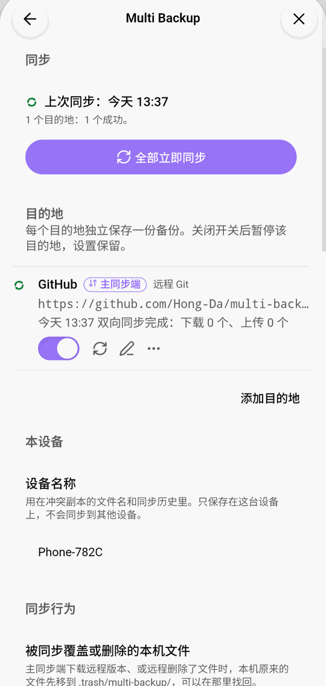
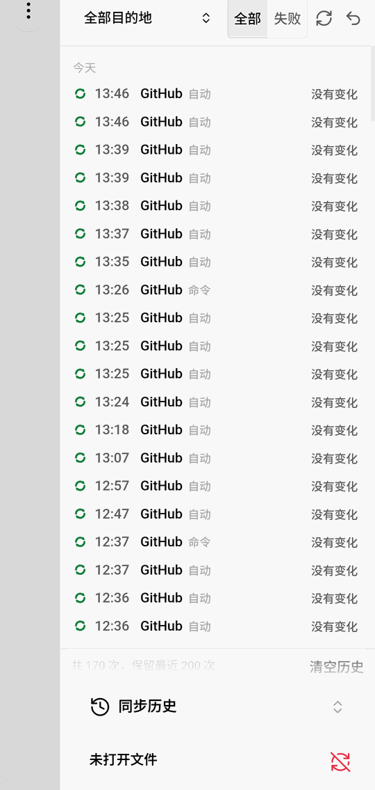
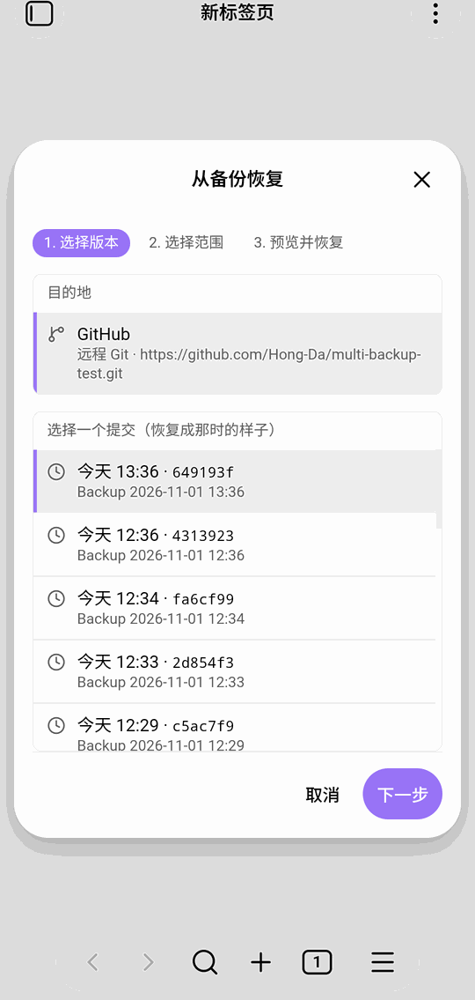

<p align="center"></p>

# 多点备份（Multi Backup）

[English](README.md) | **简体中文**

把 Vault 同时备份到多个地方：本地文件夹、Git 托管平台、WebDAV、S3 兼容存储和网盘。选其中一个作为**主同步端**，让多台设备双向同步；其余的作为单向备份，随时可以从中恢复。

桌面端和手机端都能用。本地文件夹类的目的地只在桌面端可用。

<p align="center">



</p>

带截图的完整说明：**[使用说明](docs/guide.zh-CN.md)**。

## 功能

- **同时备份到多个目的地**
  - 本地文件夹镜像、zip 快照、本地 Git 仓库（桌面端）
  - GitHub、Gitee，或任何支持 HTTPS 的 Git 服务
  - WebDAV：坚果云、Nextcloud，以及通过 [Alist](docs/alist.md) 接入的国内网盘
  - S3 兼容存储：AWS S3、Cloudflare R2、MinIO、Backblaze B2 等
  - Dropbox（OneDrive、Google Drive 暂不可用）
- **通过主同步端双向同步**：修改、删除、改名都会在设备之间同步。同一个文件两边都改过时，两份都保留，列进冲突列表由你选择。
- **自动同步**：定时、停止编辑一段时间后、Obsidian 启动时、每天固定时间。每个目的地可以分别设置。
- **恢复**：从任意目的地恢复整个 Vault、某个文件夹或单个文件，可以查看单个文件的历史版本。恢复可以撤销。
- **不会弄丢本地文件**：同步失败不会改动本地文件。同步要覆盖或删除本地文件前，旧版本会先移到 `.trash/multi-backup/`。
- **配置可以带走**：插件配置可以随备份上传，也可以导出，在新设备上导入。密码和令牌不会包含在内。

## 安装

**从社区插件安装**（审核通过后）：设置 → 第三方插件 → 浏览，搜索“Multi Backup”，安装并启用。

**手动安装**：从[最新 Release](https://github.com/Hong-Da/Obsidian-multi-backup/releases/latest) 下载 `main.js`、`manifest.json`、`styles.css`，放到 `<Vault>/.obsidian/plugins/multi-backup/`，再到设置 → 第三方插件中启用。

需要 Obsidian 1.11.4 或更新版本。

## 开始使用

1. 打开设置 → Multi Backup，点 **添加目的地**。
2. 选择类型，填写地址和账号，点 **测试连接** 检查。
3. 在命令面板运行 **Multi Backup：全部立即同步**，或在状态栏的多点备份菜单里同步（桌面端）。
4. 要在多台设备间同步：在目的地的菜单里选 **设为主同步端…**。插件会先比较两边，列出首次同步要做什么；首次同步不删除任何文件。每台设备都这样设置一次。

左侧边栏的图标打开同步历史；冲突列表、恢复、单个文件的历史版本在命令面板里。每个界面的说明见[使用说明](docs/guide.zh-CN.md)。

## 隐私、网络与账号

- **网络**：插件只连接你添加的目的地，用来备份和同步文件；网盘还会连接对应的登录服务。不收集使用数据，没有广告。
- **账号**：远程目的地需要对应服务的账号（例如 GitHub、S3 服务商、Dropbox）。插件本身免费，不需要注册。
- **凭据**：密码、令牌和网盘登录信息只保存在每台设备上 Obsidian 的密钥存储里，不会写进插件的设置文件、日志或备份内容；日志中会隐藏它们。
- **Vault 以外的文件**：本地文件夹类目的地（仅桌面端）会写入你选择的文件夹，它在 Vault 之外。除此之外不读写 Vault 以外的文件。
- **上传哪些内容**：Vault 中的文件，去掉你设置的排除项。`.obsidian` 配置文件夹只有在你打开相应设置后才会包含。

## 开发

```
start.bat        # 或 ./start.sh：准备 Node 与 pnpm、安装依赖、构建并部署到 dev-vault/，进入 watch
test.bat         # 或 ./test.sh：类型检查、代码检查、单元测试
pnpm test:accept # 里程碑验收测试（数据量大，不在一键测试中）
scripts/test-services.sh  # 集成测试：在 Docker 里启动 Gitea、WebDAV、S3（用测试机：MB_DOCKER_SSH=root@<地址>）
node scripts/release-check.mjs  # 上架检查：manifest、versions.json 与社区插件提交规则
node scripts/check-public.mjs   # 公开内容检查：内部文件、令牌、私钥、内部编号（推送前自动跑）
```

发布：`pnpm version <新版本号>` 同步 manifest 与 versions.json，提交后推送 `v<版本号>` 标签；GitHub Actions 会检查、测试、构建，并建一个不带 v 的草稿 Release（Obsidian 按版本号找 Release），在 GitHub 上确认后点发布。上架步骤见 [docs/release.md](docs/release.md)。

### 项目结构

```
multi-backup/
├── src/                    插件源码：main.ts、sync-service.ts、core/（不依赖 obsidian）、destinations/、platform/、ui/、i18n/
├── tests/                  unit/（单元）、integration/（Docker 服务）、perf/（性能）、e2e/（模拟器端到端）、acceptance/（里程碑验收）、support/、mocks/
├── docker/                 compose.test.yml：集成测试服务（Gitea、rclone WebDAV、rclone S3）
├── dev-vault/              本地测试 Vault（不入库）
├── assets/brand/           Logo 与图标
├── docs/                   guide.md / guide.zh-CN.md（使用说明）、images/（截图）、release.md（发布与上架）、alist.md、cloud-apps.md、changelog/
├── scripts/                env.bat/env.sh、version.mjs、release-check.mjs、check-public.mjs、buffer-shim.mjs（打包时注入 Buffer）、test-services.sh/.bat
├── .github/workflows/      ci.yml（测试）、release.yml（推送版本标签时建草稿 Release）
├── .githooks/              pre-push：推送前跑公开内容检查（启用：git config core.hooksPath .githooks）
├── .toolchain/             项目内 Node、pnpm 存储与缓存（不入库）
├── manifest.json  versions.json  package.json  tsconfig.json  esbuild.config.mjs
├── start.bat/.sh  test.bat/.sh
├── README.md  README.zh-CN.md
└── LICENSE                 MIT
```

文档：[使用说明](docs/guide.zh-CN.md)、[更新记录](CHANGELOG.md)、[发布与上架](docs/release.md)、[网盘应用注册](docs/cloud-apps.md)、[Alist 接入](docs/alist.md)。

## 协议

[MIT](LICENSE)
