# Multi Backup user guide

**English** | [简体中文](guide.zh-CN.md)

Multi Backup backs up your vault to several places at once. You can also pick one of them as the **primary** to keep several devices in sync both ways. Most screenshots come from Obsidian on a phone; see [On the desktop](#on-the-desktop) for the desktop.

- [Getting started](#getting-started)
- [On the desktop](#on-the-desktop)
- [The settings page](#the-settings-page)
- [Destinations](#destinations)
- [Automatic sync](#automatic-sync)
- [Syncing several devices](#syncing-several-devices)
- [Sync history](#sync-history)
- [Restoring from a backup](#restoring-from-a-backup)
- [New device: import the plugin configuration](#new-device-import-the-plugin-configuration)
- [Security and privacy](#security-and-privacy)
- [FAQ](#faq)

## Getting started

When you enable the plugin, a welcome dialog offers two paths:

- **Start fresh**: add your first backup location and run the first backup.
- **I've used it on another device**: connect to the destination your other device uses, then import its settings.

After “Start fresh”, choose where backups go. On a computer the simplest choice is another folder, such as an external drive. Phones can't write outside the vault, so choose an online destination there.

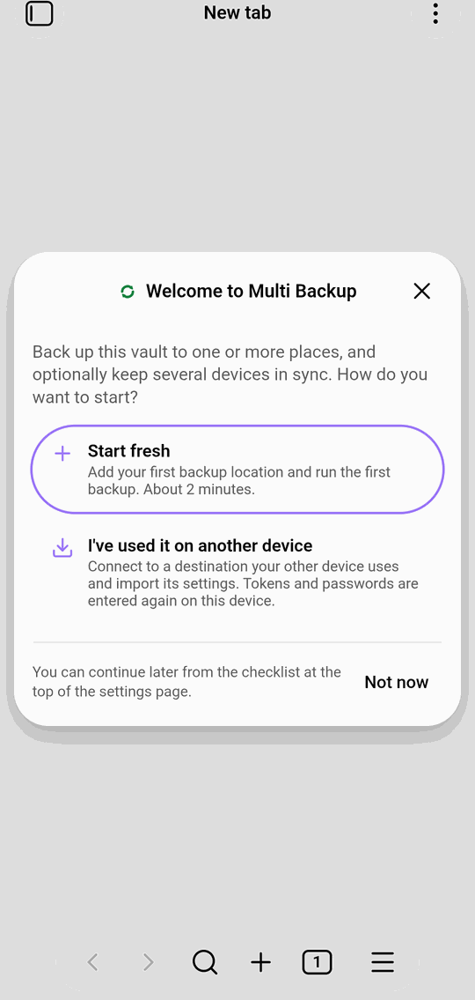
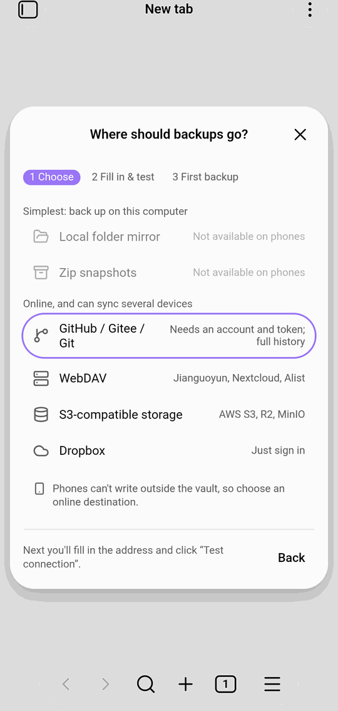

Fill in the destination and click **Test connection**. After you save, the plugin offers to run the first backup. From then on a **getting-started checklist** sits at the top of the settings page:

1. Add a destination
2. Run the first backup
3. Turn on automatic sync
4. Sync between devices (optional)

The checklist ticks itself off from what you've actually done, and shows “You're all set” once the first three are done. Close it with the × in its corner. To bring it back, run **Multi Backup: Show getting started guide** from the command palette.

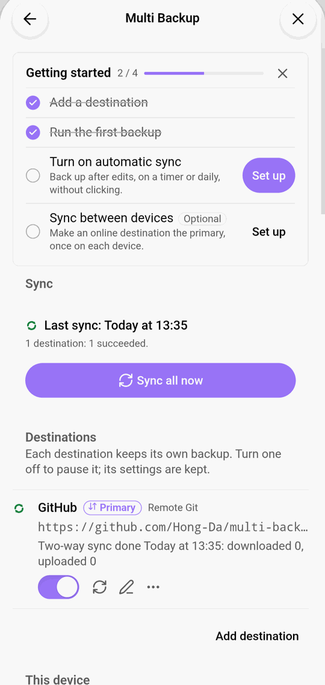

## On the desktop

The desktop shows the same screens in a wider window. The sync history stays in the right sidebar, and the status bar item in the bottom-right corner shows the last sync; click it to sync everything or one destination, open the history, or restore.

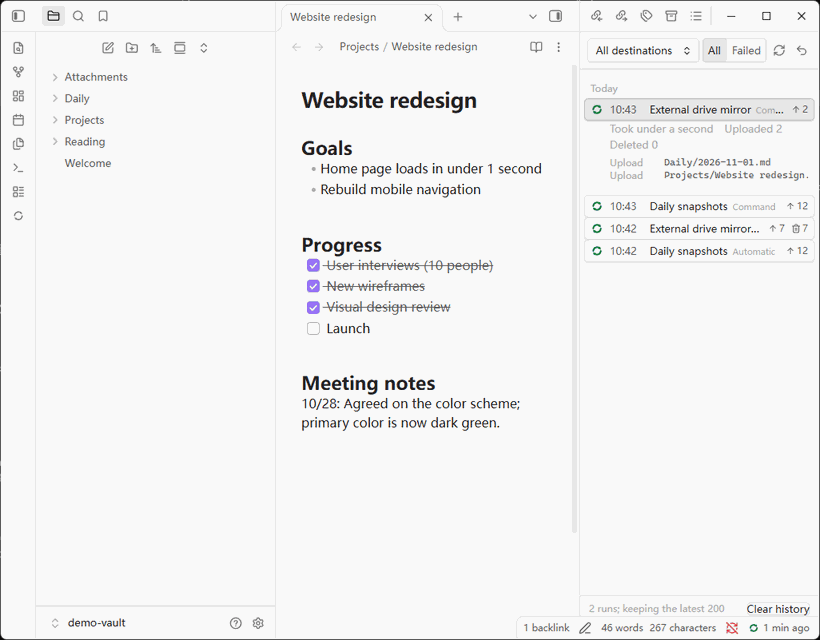

The settings page opens in its own window:

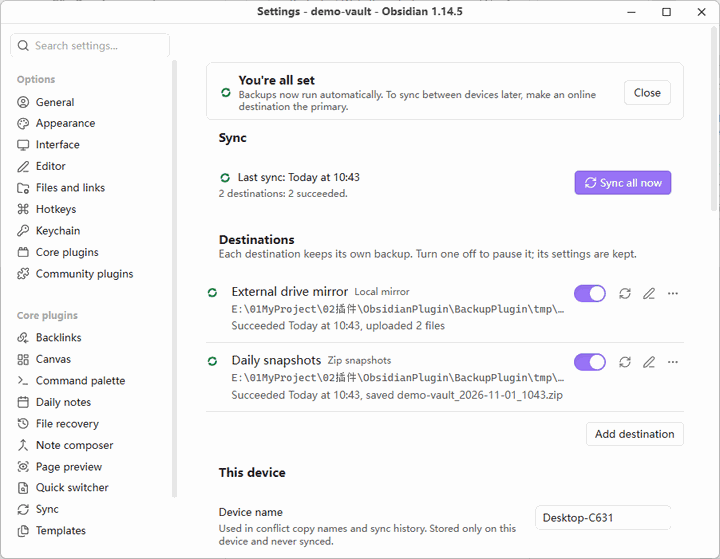

## The settings page

From top to bottom:

- **Sync**: when the last sync ran and how it went, plus **Sync all now**.
- **Destinations**: one row per destination with its type, address and last result. On the right: the on/off switch, sync now, edit, and more (make primary, view history, duplicate, delete).
- **This device**: the device name, used in conflict copies and in the sync history.
- **Sync behavior**: how long local files that a sync overwrites or deletes stay in `.trash/multi-backup/`, and whether to sync before closing Obsidian.
- **What gets backed up**: whether to include the Obsidian config folder, exclusions, and the maximum file size.
- **Plugin configuration**: export and import the plugin's settings.
- **Logging**: debug log and log export.

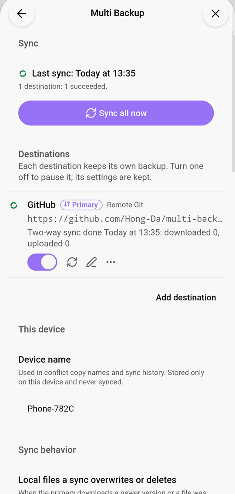

## Destinations

| Type | Good for | Notes |
|---|---|---|
| Local folder mirror | An external or second drive | Desktop only; keeps a copy identical to the vault |
| Zip snapshots | Keeping dated versions | Desktop only; choose how many to keep and for how long |
| Local Git repository | Recording every change with Git | Desktop only |
| GitHub / Gitee / any Git host | Online backup and multi-device sync | Needs an account and token; every sync is a commit you can browse on the website |
| WebDAV | Jianguoyun, Nextcloud, other drives through [Alist](alist.md) | Needs the address, user name and password (an app password for Jianguoyun) |
| S3-compatible storage | AWS S3, Cloudflare R2, MinIO, Alibaba OSS and others | Needs an access key |
| Dropbox | An existing Dropbox account | Sign in through the browser; backups go to Dropbox's Apps folder |

Every destination's edit dialog has **Test connection**. Below the token, password or access key there is a **How to get** card with steps for the selected platform or provider, a button that opens the page where you create it, and for S3 a policy limited to this bucket that you can copy. It opens by itself when you add a destination. Tokens and passwords live only in this device's secret storage, so each device picks them once.

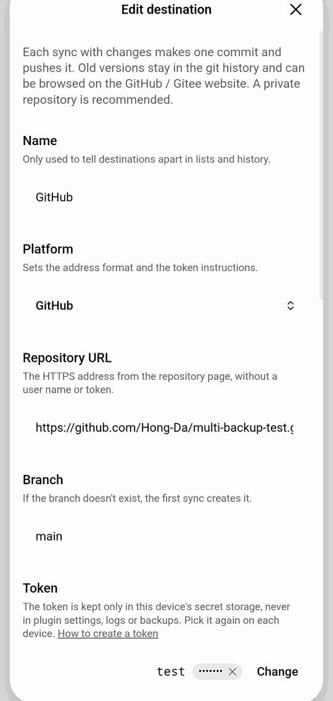

## Automatic sync

Automatic sync is set per destination, in its edit dialog:

- **On a timer**: every few minutes.
- **After edits**: after you stop editing for a while, so continuous typing doesn't trigger it repeatedly.
- **When Obsidian starts**.
- **Daily at** a set time.

Any one of them triggers a sync. On phones it runs only while Obsidian is open. New destinations sync every 30 minutes by default; when a destination becomes the primary, the default changes to 30 seconds after edits, at startup, and every 10 minutes.

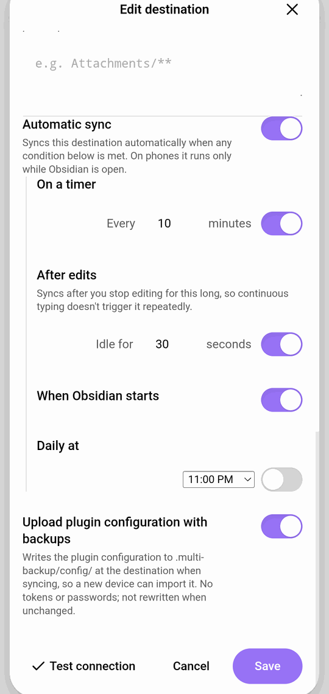

## Syncing several devices

A normal destination is a **one-way backup**: it only receives this device's files. To keep devices identical, **make an online destination the primary** (Git, WebDAV, S3 or Dropbox):

1. In the destination's “⋯” menu, choose **Make primary…**.
2. The plugin first compares this device with the destination without changing anything and shows what the first sync will do. The first sync deletes nothing: files that exist on only one side are copied to the other.
3. Confirm to start two-way sync. Do this once on each device.

From then on, edits, new files, deletions and renames sync between devices. When a file changed on both sides, both versions are kept (the remote one is saved as a conflict copy) and listed in the **conflict list** for you to choose. Before a sync overwrites or deletes a local file, the old version is moved to `.trash/multi-backup/`.

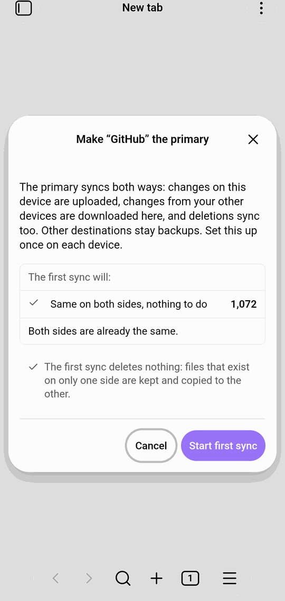

## Sync history

The ribbon icon opens the sync history, which stays in the right sidebar. Each sync is one entry: time, destinations, what triggered it, how many files were uploaded or deleted, and why anything failed. Filter by destination or show failures only, and click an entry for the list of changes. The buttons at the top sync now or open restore.

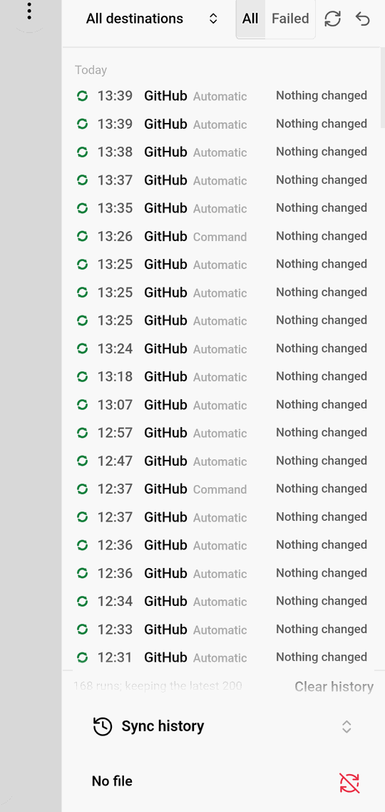

## Restoring from a backup

Run **Multi Backup: Restore from backup…** from the command palette:

1. **Choose version**: the destination and the point in time (a Git commit, a zip snapshot and so on).
2. **Choose what**: the whole vault, a folder, or some files.
3. **Preview & restore**: see which files will be overwritten or added, then confirm.

The current local files are saved first, so a restore can be undone. For one file's history, right-click the file and choose **Version history…**, or run **Multi Backup: Version history of the current file…**. Pick a version on the left to see its content.

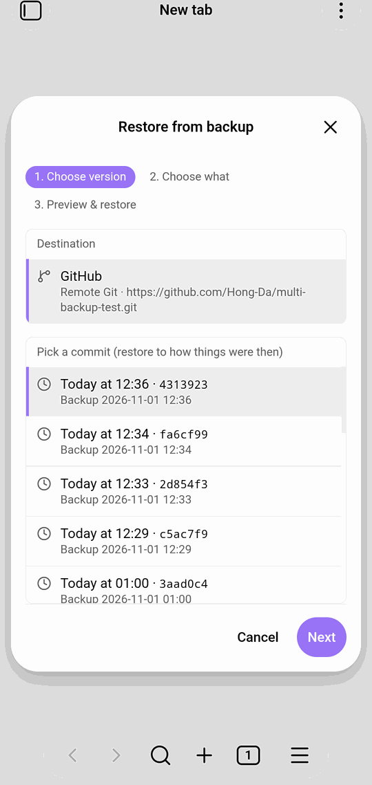
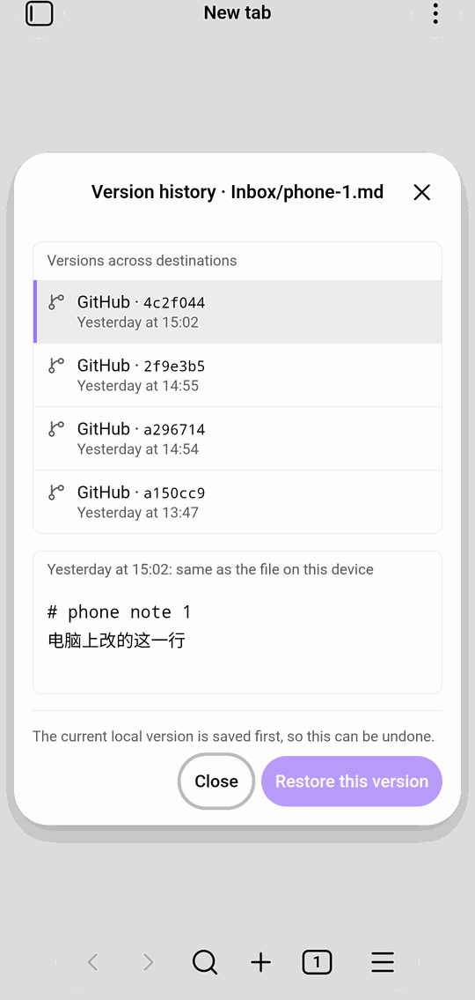

## New device: import the plugin configuration

By default each destination also stores the plugin configuration (without tokens or passwords). On a new device:

1. Install the plugin and choose **I've used it on another device** in the welcome dialog.
2. Add the destination your other device uses and enter its token or password.
3. After saving, import from that destination. If several devices uploaded a configuration, pick the one you want.
4. Afterwards, pick secrets where needed, and set the primary again (it compares first).

You can also export the configuration to a file in **Plugin configuration** on the settings page and import it on the other device.

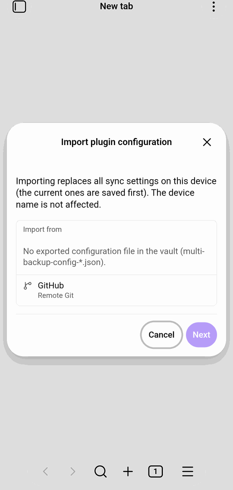

## Security and privacy

- Tokens, passwords and cloud sign-ins are stored only in Obsidian's secret storage. They are never written to the plugin's settings file, logs or backups, and logs mask them.
- The plugin only connects to the destinations you add (and, for cloud drives, their sign-in service). It collects no usage data.
- A failed sync never changes your local files.

## FAQ

**A sync failed. What now?** The settings page and the sync history say why: an expired token, an unreachable server, a full disk and so on. Fix the destination as suggested and sync again. Your local files are not changed by a failed sync.

**Why can't I choose a local folder on my phone?** Obsidian on phones can't write outside the vault. Choose an online destination.

**Which files are not synced?** Files matching the exclusions under “What gets backed up”, files over the size limit, and the plugin's own runtime data. The Obsidian config folder is included by default and can be turned off.

**Can I get a deleted file back?** Before a sync deletes or overwrites a local file, the old version goes to `.trash/multi-backup/` and stays 30 days by default. You can also restore any version from a destination.
