# 多点备份使用说明

[English](guide.md) | **简体中文**

多点备份把 Vault 同时备份到多个地方，也可以选其中一个作为**主同步端**，让多台设备双向同步。本说明的截图大多来自手机上的 Obsidian，电脑上的样子见[电脑上](#电脑上)。

- [第一次使用](#第一次使用)
- [电脑上](#电脑上)
- [设置页](#设置页)
- [目的地](#目的地)
- [自动同步](#自动同步)
- [多台设备同步](#多台设备同步)
- [同步历史](#同步历史)
- [从备份恢复](#从备份恢复)
- [换设备：导入插件配置](#换设备导入插件配置)
- [安全与隐私](#安全与隐私)
- [常见问题](#常见问题)

## 第一次使用

启用插件后会弹出欢迎窗口，有两条路：

- **新开始**：添加第一个备份位置，完成第一次备份。
- **我在别的设备上用过**：先连上另一台设备在用的目的地，再导入那边的设置。

选“新开始”后选择备份到哪里。电脑上最简单的是备份到另一个文件夹（如移动硬盘）；手机上不能写 Vault 以外的文件夹，要选一个在线目的地。

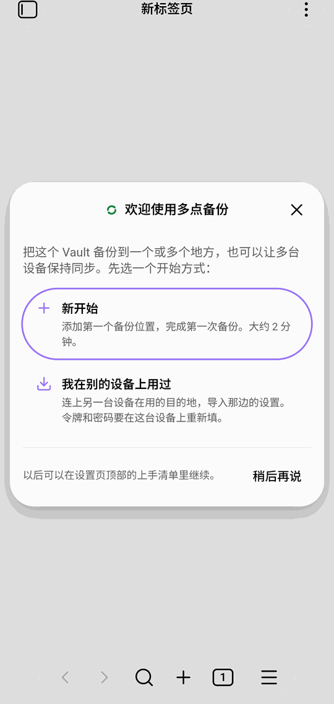
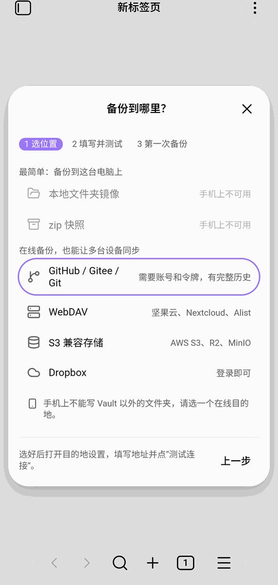

填好目的地并点“测试连接”，保存后插件会问要不要立即做第一次备份。之后设置页顶部有一张**上手清单**：

1. 添加一个目的地
2. 完成第一次备份
3. 打开自动同步
4. 在多台设备间同步（可选）

清单会按实际状态自动打勾，前三项做完后显示“基本设置都完成了”。点右上角的 × 可以关掉；以后要重新显示，在命令面板运行 **Multi Backup：显示上手指南**。

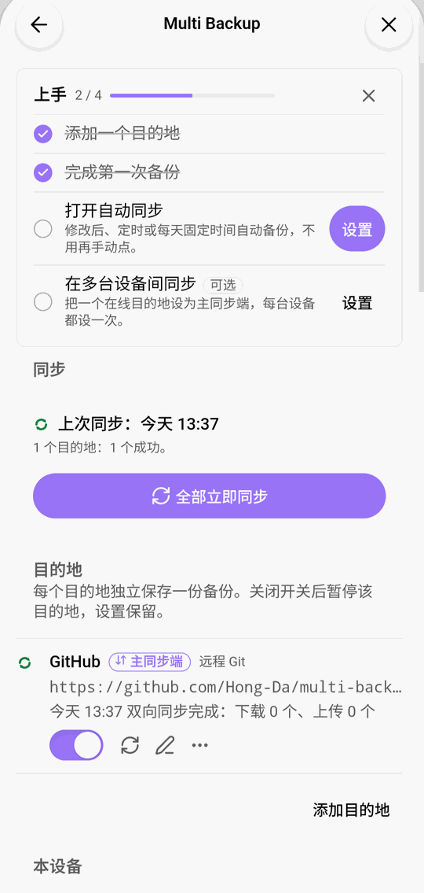

## 电脑上

电脑上的界面和手机相同，只是更宽：同步历史常驻在右侧边栏，右下角的状态栏显示上次同步的时间，点它可以立即同步、同步单个目的地、打开同步历史或恢复。

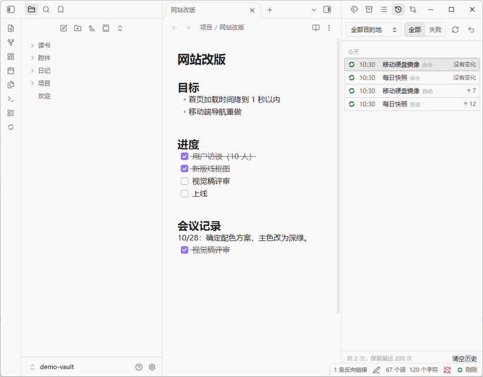

设置页在单独的窗口里：

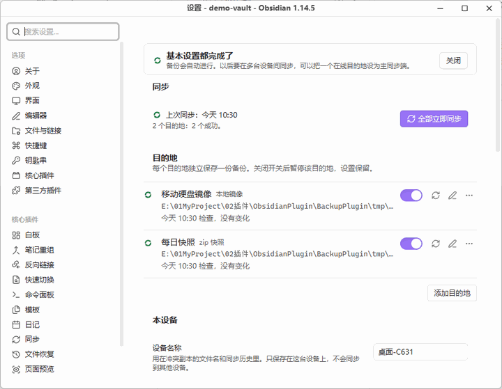

## 设置页

设置页从上到下：

- **同步**：上次同步的时间和结果，以及“全部立即同步”按钮。
- **目的地**：每个目的地一行，显示类型、地址和上次同步的结果。右边依次是启用开关、立即同步、编辑和更多操作（设为主同步端、查看历史、复制、删除）。
- **本设备**：设备名称，用在冲突副本的文件名和同步历史里。
- **同步行为**：被同步覆盖或删除的本机文件在 `.trash/multi-backup/` 保留几天；关闭 Obsidian 前是否同步一次。
- **文件范围**：是否包含 Obsidian 配置文件夹、排除规则、单个文件的大小上限。
- **插件配置**：导出、导入插件设置。
- **日志**：调试日志开关、导出日志。

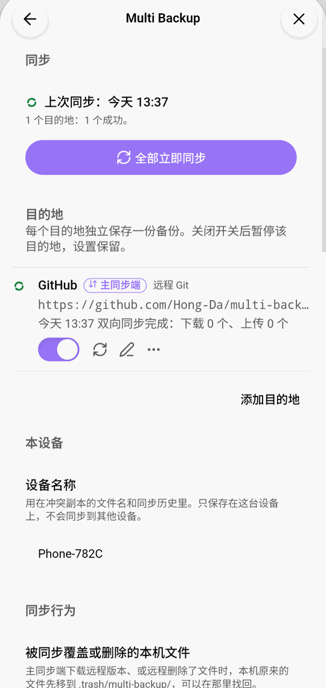

## 目的地

| 类型 | 适合 | 说明 |
|---|---|---|
| 本地文件夹镜像 | 移动硬盘、另一块磁盘 | 只在电脑上可用；保持一份和 Vault 一样的副本 |
| zip 快照 | 按时间保留多个版本 | 只在电脑上可用；可以设置保留几份、保留几天 |
| 本地 Git 仓库 | 想用 Git 记录每次改动 | 只在电脑上可用 |
| GitHub / Gitee / 其他 Git | 在线备份、多设备同步 | GitHub 可以直接用账号登录，其他平台需要令牌；每次同步是一个提交，可以在网页上看历史 |
| WebDAV | 坚果云、Nextcloud、通过 [Alist](alist.md) 接入的网盘 | 需要地址、用户名和密码（坚果云用应用密码） |
| S3 兼容存储 | AWS S3、Cloudflare R2、MinIO、阿里云 OSS 等 | 需要访问密钥 |
| Dropbox | 已有 Dropbox 账号 | 在浏览器里登录授权；备份放在 Dropbox 的“应用”文件夹里 |

每个目的地的编辑窗口里都有“测试连接”。令牌、密码或访问密钥下面有一张“如何获取”的指导卡片：按所选的平台或服务商写明步骤，有按钮直接打开创建页面，S3 还能复制只允许这个桶的权限策略；添加目的地时会自动展开。令牌、密码只保存在这台设备的密钥存储里，每台设备要分别选一次。

GitHub 默认用 **用 GitHub 登录**：点登录后插件显示一个代码，在浏览器打开 github.com/login/device 输入代码并授权。授权用的是插件的 GitHub 应用 Obsidian Multi Backup，它只能访问你装了它的仓库，权限只有仓库内容的读写。登录后插件会检查这个仓库有没有装上应用，没装时点 **安装到仓库**，选 **Only select repositories** 并选备份仓库。想自己管理令牌，可以把“连接方式”改为 **手动填令牌**。登录得到的令牌也只存在这台设备上，每台设备各登录一次。

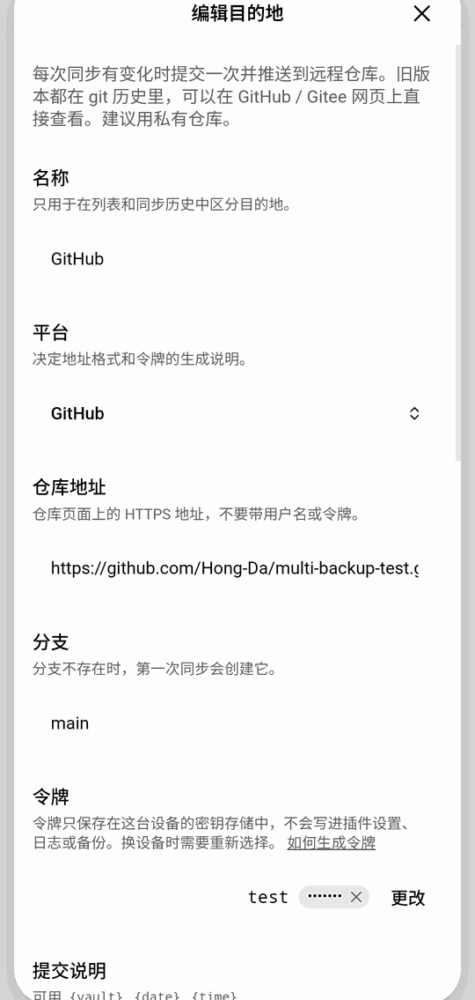

## 自动同步

自动同步按目的地分别设置，在目的地的编辑窗口里：

- **定时**：每隔几分钟同步一次。
- **修改后**：停止编辑一段时间后同步，连续打字时不会反复触发。
- **启动 Obsidian 时**。
- **每天固定时间**。

满足任一条件就会同步。手机上只在 Obsidian 打开时运行。新目的地默认每 30 分钟同步一次；设为主同步端后默认改为“修改后 30 秒 + 启动时 + 每 10 分钟”。

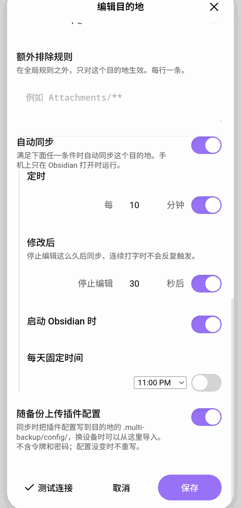

## 多台设备同步

普通目的地是**单向备份**：只把这台设备的内容传上去。要让多台设备保持一致，把一个在线目的地（Git、WebDAV、S3、Dropbox）**设为主同步端**：

1. 在目的地右边的“⋯”菜单里选 **设为主同步端…**。
2. 插件先只读地比较这台设备和目的地，列出首次同步要做什么。首次同步不删除任何文件：只在一边有的文件会复制到另一边。
3. 确认后开始双向同步。每台设备都这样设置一次。

之后修改、新增、删除、改名都会在设备之间同步。同一个文件两边都改过时，两份都保留（远程的那份另存为冲突副本），并列进**冲突列表**，由你选择保留哪一份。同步要覆盖或删除本机文件前，旧版本先移到 `.trash/multi-backup/`。

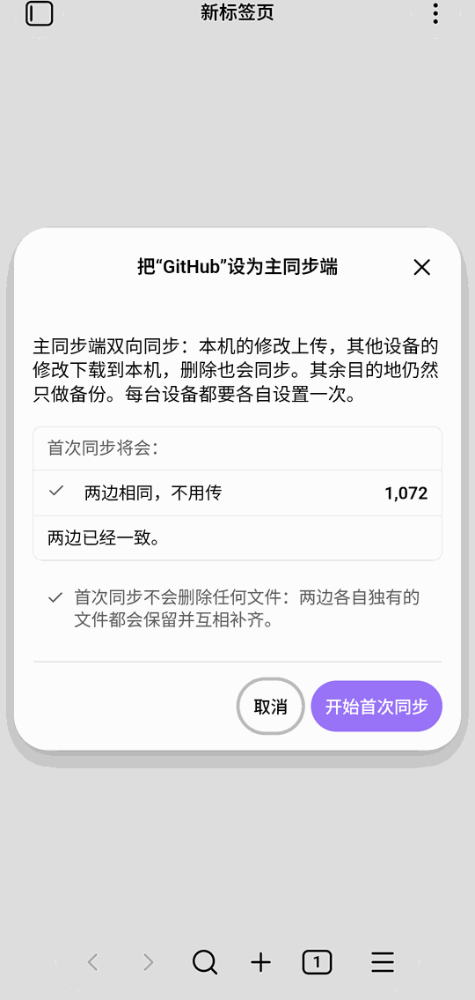

## 同步历史

左侧边栏的图标打开同步历史，它常驻在右侧边栏。每次同步一条记录：时间、目的地、触发方式、上传和删除了多少文件、失败的原因。可以只看某个目的地或只看失败的记录，点一条记录展开改动明细。顶部按钮可以立即同步或打开恢复。

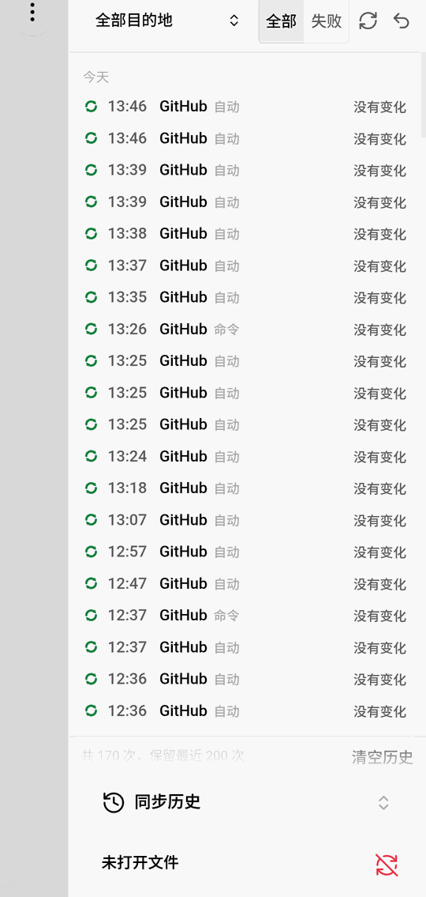

## 从备份恢复

命令面板运行 **Multi Backup：从备份恢复…**：

1. **选择版本**：选目的地和要恢复到的时间点（Git 的提交、zip 快照等）。
2. **选择范围**：整个 Vault、某个文件夹或几个文件。
3. **预览并恢复**：先列出会覆盖和新增哪些文件，确认后恢复。

恢复前，本机现在的版本会先另存一份，所以恢复可以撤销。单个文件的历史版本：在文件上右键选 **历史版本…**，或运行 **Multi Backup：当前文件的历史版本…**，左边选版本，右边看内容。

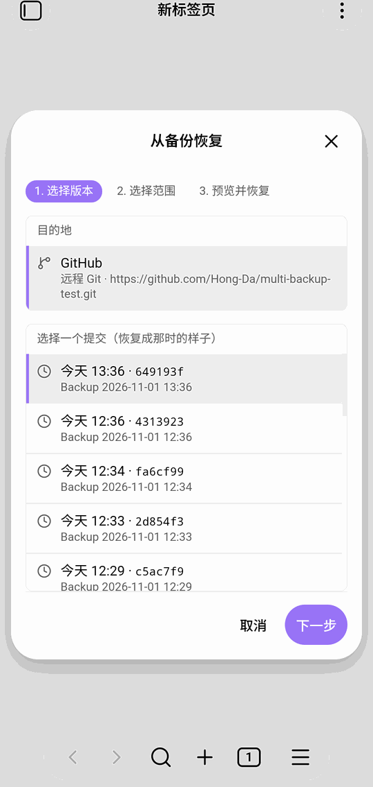
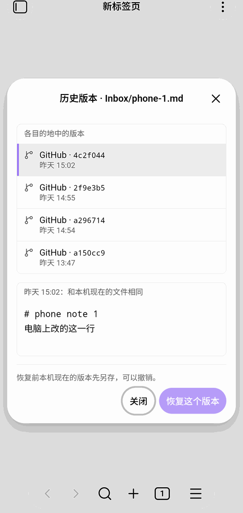

## 换设备：导入插件配置

目的地默认会随备份上传插件配置（不含令牌和密码）。在新设备上：

1. 安装插件，在欢迎窗口选 **我在别的设备上用过**。
2. 添加另一台设备在用的那个目的地，填写令牌或密码。
3. 保存后选择从这个目的地导入；有多台设备上传过配置时，选择要导入的那一份。
4. 导入后在需要的目的地里选择密钥；主同步端要重新设置一次（会先比较）。

也可以在设置页的“插件配置”里导出成文件，再在另一台设备上导入。

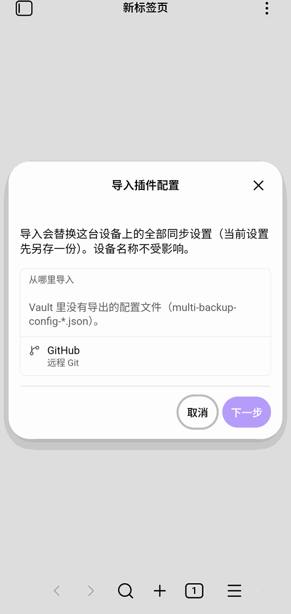

## 安全与隐私

- 令牌、密码和网盘登录信息只保存在 Obsidian 的密钥存储里，不写进插件的设置文件、日志或备份内容；日志中会隐藏它们。
- 插件只连接你添加的目的地（网盘还会连接对应的登录服务），不收集使用数据。
- 同步失败不会改动本地文件。

## 常见问题

**同步失败了怎么办？** 设置页和同步历史会写明原因，例如令牌失效、连不上服务器、空间不足。按提示修改目的地后点立即同步；本地文件不会因为失败而改动。

**手机上为什么不能选本地文件夹？** 手机上的 Obsidian 不能写 Vault 以外的文件夹，请选在线目的地。

**哪些文件不会同步？** 设置页“文件范围”里的排除规则、超过大小上限的文件，以及插件自己的运行数据。Obsidian 配置文件夹默认包含，可以关掉。

**删除的文件能找回吗？** 同步删除或覆盖本机文件前，旧版本先进 `.trash/multi-backup/`，默认保留 30 天；也可以从任何目的地恢复历史版本。
